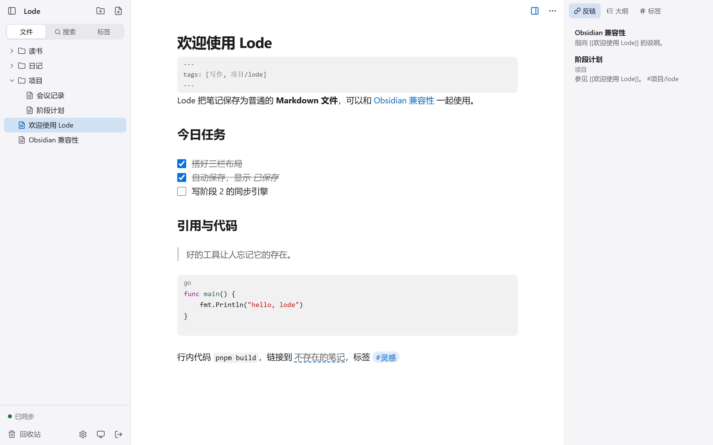
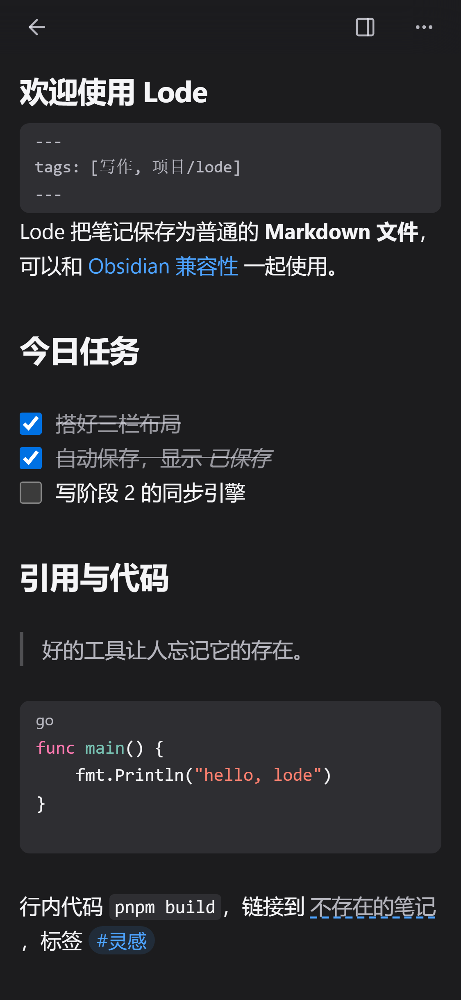

# Lode

自托管、单用户的 Markdown 笔记：可安装为 PWA，多端即时同步，自带 Agent 助手并对外提供 MCP。一个 Go 二进制加 SQLite，512MB 内存的 VPS、NAS 或树莓派就能跑。

<p>
  
  
</p>

## 特性

- **笔记就是文件**：每篇笔记是数据目录 `vault/` 下的普通 `.md` 文件，可以直接用 Obsidian 或任何编辑器打开；在外部改动会自动同步进来。
- **链接与检索**：`[[双向链接]]`、反链、`#标签`、支持中文的全文搜索、快速切换器（`Ctrl/⌘ K`）。
- **多端同步**：自动保存，WebSocket 实时推送到其他设备；离线也能编辑，联网后自动合并，真冲突时生成冲突副本，不丢数据。
- **PWA**：手机和电脑都能安装到主屏幕；Apple 风格的界面和手势，支持深色模式和减弱动态效果。
- **Agent 助手**：接入 OpenAI 兼容（OpenRouter、DeepSeek 等）、Anthropic、Gemini 的多个模型，每个模型单独设置上下文窗口、推理强度和输入模态；助手能搜索、阅读和修改笔记，改动前需要你确认。
- **MCP 服务**：Claude Code、Codex、Cursor 等 agent 用 API token 通过 `/mcp` 访问你的笔记，可以只读或读写。
- **好运维**：附件、回收站；`lode backup` / `lode restore` 一个文件备份全部数据；启动时自动迁移数据库，迁移前自动备份。

## 快速开始

### Docker（推荐）

```bash
git clone https://github.com/rt-game-440/lode.git && cd lode
echo "LODE_SECRET_KEY=$(openssl rand -base64 32)" > .env
docker compose up -d
```

打开 <http://127.0.0.1:8787>，第一次访问时设置登录密码。数据在 Docker 卷 `lode-data` 里。

`.env` 里的 `LODE_SECRET_KEY` 用来加密助手的 API key，要长期保存，更换后已保存的 key 需要重新填写。只用笔记、不用助手可以不设置。

`v0.1.0` 发布后也可以不克隆仓库，直接运行镜像（`linux/amd64`、`linux/arm64`、`linux/arm/v7`）：

```bash
docker run -d --name lode --restart unless-stopped -p 127.0.0.1:8787:8787 -v lode-data:/data -e LODE_SECRET_KEY=<你保存的主密钥> ghcr.io/rt-game-440/lode:latest
```

### 二进制

从 [GitHub Releases](https://github.com/rt-game-440/lode/releases) 下载对应平台的文件（Linux amd64 / arm64 / armv7、Windows、macOS），用 `SHA256SUMS` 校验后运行：

```bash
chmod +x lode-v0.1.0-linux-amd64
LODE_DATA_DIR=/var/lib/lode ./lode-v0.1.0-linux-amd64 serve
```

作为 systemd 服务长期运行见 [docs/deploy.md](docs/deploy.md)。从源码构建：`scripts/build.sh`（需要 Go 和 pnpm），输出 `bin/lode`。

### HTTPS 与反向代理

手机安装 PWA、在外网访问都需要 HTTPS。仓库带了 Caddy 的配置，会自动申请证书：

```bash
LODE_DOMAIN=notes.example.com docker compose -f docker-compose.yml -f deploy/compose.caddy.yml up -d
```

域名要先解析到这台机器，80 和 443 端口能从公网访问。用其他反向代理时，要转发 WebSocket（`/api/ws`），不要缓冲 SSE，并把代理的地址加进 `LODE_TRUSTED_PROXIES`。详见 [docs/deploy.md](docs/deploy.md)。只在局域网里用手机测试时，见 [docs/dev-https.md](docs/dev-https.md)。

### 安装 PWA

- iPhone / iPad：用 Safari 打开站点 → 分享 → 添加到主屏幕。
- Android：用 Chrome 打开站点 → 菜单 → 安装应用。
- 电脑：Chrome / Edge 地址栏右侧的安装图标。

### 接入 MCP

在“设置 → API token”创建 token，然后（以 Claude Code 为例）：

```bash
claude mcp add --transport http lode "https://notes.example.com/mcp" --header "Authorization: Bearer $LODE_TOKEN"
```

其他客户端的写法和工具列表见 [docs/mcp.md](docs/mcp.md)。

### 配置助手

设置好 `LODE_SECRET_KEY` 后，在“设置 → 助手”添加供应商、填 API key、选择模型。各供应商的接入方式和推理强度映射见 [docs/agent.md](docs/agent.md)。

## 环境变量

| 变量 | 默认值 | 说明 |
|---|---|---|
| `LODE_ADDR` | `127.0.0.1:8787`（镜像里是 `0.0.0.0:8787`） | 监听地址 |
| `LODE_DATA_DIR` | `./data`（镜像里是 `/data`） | 数据目录：`app.db`、`vault/`（笔记和附件）、`trash/`、`backups/` |
| `LODE_SECRET_KEY` | 空 | 加密助手 API key 的主密钥，`openssl rand -base64 32` 生成。不设置就不能保存 key；更换后已存的 key 失效 |
| `LODE_LOG_LEVEL` | `info` | `debug`、`info`、`warn`、`error` |
| `LODE_TRUSTED_PROXIES` | `127.0.0.0/8,::1` | 可信反向代理的 IP 或 CIDR，逗号分隔。只有来自这些地址的 `X-Forwarded-For` / `X-Forwarded-Proto` 会被采用 |
| `GOMEMLIMIT` | 镜像里是 `100MiB` | Go 运行时的软内存上限，小内存机器可以调低 |

## 运维命令

```bash
lode backup lode-backup.tar.gz     # 在线备份数据库和全部文件，服务运行中也可以执行
lode restore lode-backup.tar.gz    # 从备份恢复，需要先停止服务；原数据移到数据目录下的 pre-restore-<时间>/
lode reset-password                # 忘记密码时在服务器上重置
lode healthcheck                   # 检查本机服务是否正常
lode --version
```

在 Docker 里运行时加上 `docker compose exec lode` 前缀，或参考 [docs/deploy.md](docs/deploy.md) 的备份与恢复。

## 文档

- 部署、升级、备份与恢复：[docs/deploy.md](docs/deploy.md)
- HTTP 接口：[docs/api.md](docs/api.md)
- MCP 接入：[docs/mcp.md](docs/mcp.md)
- 助手与模型供应商：[docs/agent.md](docs/agent.md)
- 性能基准：[docs/benchmark.md](docs/benchmark.md)
- 产品规格：[docs/SPEC.md](docs/SPEC.md)；开发约定：[AGENTS.md](AGENTS.md)
- 更新日志：[CHANGELOG.md](CHANGELOG.md)

## 许可证

[MIT](LICENSE)
